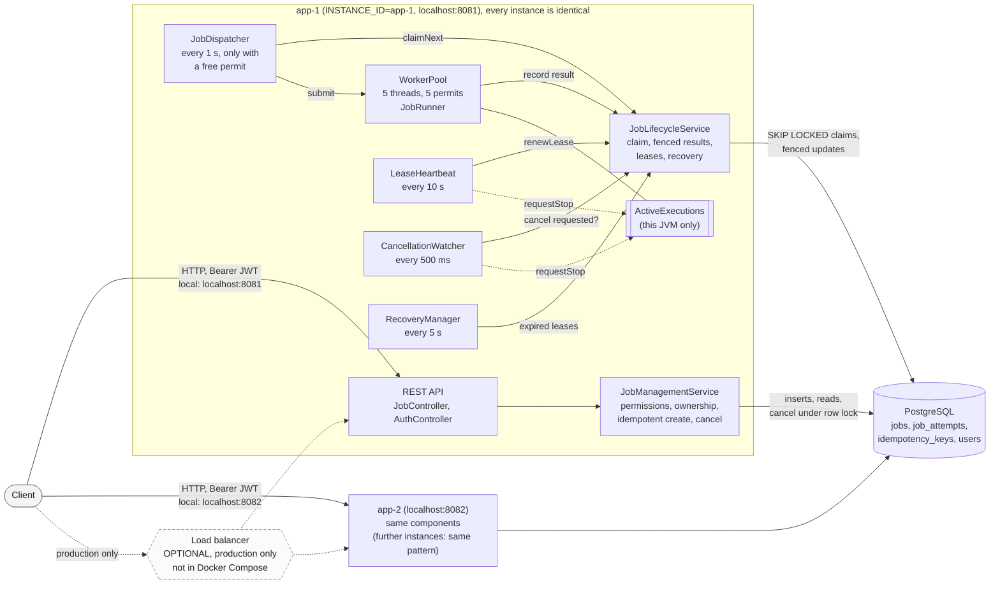

# Architecture, Decisions and Trade-offs

> **Graphical architecture diagram: [architecture.html](architecture.html)** — open it in any
> browser (no server or installation needed). It shows two application instances, every component
> below, the shared PostgreSQL database and each labelled interaction, with zoom and fit-to-screen.

This document describes the system **as implemented**; component names are the actual classes.
The original requirements are in [SPECIFICATION.md](SPECIFICATION.md); where the implementation
intentionally differs, the difference is listed in [§7](#7-deviations-from-the-original-specification).

## 1. Overview

A **modular monolith deployed as N identical instances**. Every instance is the same Spring Boot
JAR and runs the REST API *and* the background processing (dispatcher, worker pool, heartbeat,
cancellation watcher, recovery). **PostgreSQL is the single source of truth and the persistent job
queue**; every decision about job ownership is a transaction in PostgreSQL. Local memory only
holds what this process is executing right now.

### How instances coordinate

Instances **never call each other** and share no in-memory state. They coordinate only through
rows and row locks in PostgreSQL:

- **Work distribution:** each instance's dispatcher claims jobs with `SELECT … FOR UPDATE SKIP
  LOCKED`, so two instances never claim the same job and never wait for each other.
- **Ownership:** a claimed job carries `worker_id`, `lease_until` and a `fencing_token`. Every
  later write by the worker is conditional on those values.
- **Liveness:** the owner renews its lease every 10 s; a lease that is not renewed expires, and the
  Recovery Manager of *any* instance takes the job over.
- **Cancellation:** `DELETE` can arrive at any instance; it only changes the row
  (`CANCEL_REQUESTED`). The owning instance discovers it by polling PostgreSQL.
- **Clock:** leases, retry times and key expiry use the database clock (`now()`), so clock skew
  between instances does not matter.

## 2. Architecture diagram

The detailed diagram is **[architecture.html](architecture.html)**. The overview below renders
directly on GitHub and uses the same component names. Solid client arrows are the local Docker
Compose setup, where the client calls `app-1` (`localhost:8081`) and `app-2` (`localhost:8082`)
directly. The dashed load balancer is optional, used only in production, and is **not** part of
Docker Compose. Instances never call each other; they coordinate only through PostgreSQL.



### Components

| Component (class) | Responsibility | Talks to |
|---|---|---|
| **REST API** (`JobController`, `AuthController`) | HTTP mapping only: validation, status codes, ProblemDetail errors. JWTs are validated locally by Spring Security (no database call); login checks the `users` table through `AuthenticationService`. | `JobManagementService` |
| **`JobManagementService`** | Client operations: create (idempotent, via `IdempotentJobCreator`), get, list, attempts, cancel (row lock, then `PENDING → CANCELLED` or `RUNNING → CANCEL_REQUESTED`). `@PreAuthorize` on every method; every query is scoped to the caller. | PostgreSQL |
| **`JobLifecycleService`** | Internal Job Management operations for the background components: `claimNext`, `complete`, `fail`, `confirmCancelled`, `releaseClaim`, `renewLease`, `findCancellationRequests`, `recoverNextExpiredLease`. The only code that changes a claimed job. | PostgreSQL |
| **`JobDispatcher`** | Own thread, polls every 1 s; claims one job at a time while a worker permit is free and submits it to the pool. Executes no business logic. | `JobLifecycleService`, `WorkerPool` |
| **`WorkerPool`** | 5 threads, one semaphore permit per thread, executor queue sized to the pool, explicit `AbortPolicy`, drains for 30 s on shutdown. Each task runs `JobRunner`, which runs `SimulatedJobExecutor` in interruptible 500 ms slices, classifies failures and records the outcome. | `JobLifecycleService`, `ActiveExecutions` |
| **`ActiveExecutions`** | Registry of the jobs running in this JVM; lets background threads stop a worker (`requestStop`) and holds each job's local lease deadline. Never used for cross-instance decisions. | — |
| **`LeaseHeartbeat`** | Own thread, every 10 s: renews the lease of each running job; stops workers whose ownership is lost, whose job is being cancelled, or whose local lease deadline passed. | `JobLifecycleService`, `ActiveExecutions` |
| **`CancellationWatcher`** | Own thread, every 500 ms: one query finds cancellation requests for this instance's jobs and stops those workers. | `JobLifecycleService`, `ActiveExecutions` |
| **`RecoveryManager`** (scheduled by `RecoveryScheduler`) | Own thread, every 5 s: takes over jobs whose lease expired — requeue, fail or finalize cancellation. Runs on every instance. | `JobLifecycleService` |
| **Supporting** | Security (JWT, permissions), `IdempotencyKeyCleanup` (hourly), metrics (`JobMetrics`, gauges), Flyway schema. | — |

### Job lifecycle

```
PENDING ──claim──▶ RUNNING ──success──▶ COMPLETED
   │                 │  ├──failure, retries left / lease expired──▶ PENDING (after backoff)
   │                 │  └──permanent failure / retries exhausted──▶ FAILED
   │ cancel          │ cancel
   ▼                 ▼
CANCELLED ◀──── CANCEL_REQUESTED   (worker confirms, or Recovery after lease expiry)
```

Every attempt is recorded in `job_attempts` (`RUNNING` → `SUCCEEDED` | `FAILED` | `CANCELLED` |
`ABANDONED`), with `attempt_number` equal to the fencing token of the claim that created it.

## 3. Key design decisions and trade-offs

### 3.1 PostgreSQL as the queue instead of a message broker
- **Decision:** jobs are rows; workers find work with SQL. No Kafka/RabbitMQ/Redis.
- **Why:** the job *is* the state that must be durable, queryable and authorized (status, attempts,
  ownership). Keeping queue and state in one transactional store means claiming, cancelling,
  recovering and idempotent creation are each a single ACID transaction. With a broker, every
  state change would span two systems and need an outbox or compensations.
- **Trade-off:** polling (1 s) adds up to one poll interval of start latency, and throughput is
  bounded by PostgreSQL write capacity. That is ample for minute-long jobs; at much higher volumes
  a broker becomes worth its operational cost (see §5).

### 3.2 Atomic claiming with `FOR UPDATE SKIP LOCKED`
- **Decision:** one transaction selects the oldest eligible job `FOR UPDATE SKIP LOCKED`, sets
  `RUNNING`, `worker_id`, `lease_until`, increments `fencing_token`, and inserts the attempt.
  Execution starts only after commit.
- **Why:** concurrent dispatchers on any instance never wait on or double-claim the same row;
  each skips rows another transaction holds. The partial index `idx_jobs_pending` serves the query
  without sorting (checked with `EXPLAIN` in tests).
- **Trade-off:** ordering is "oldest eligible first", not strict FIFO under contention, and
  fairness between users is not enforced. Both are acceptable for this workload.

### 3.3 Leases and heartbeats
- **Decision:** a claim grants a 30 s lease; a dedicated heartbeat thread renews it every 10 s,
  only while the job is `RUNNING` and only for the current `worker_id` + `fencing_token`.
- **Why:** ownership must expire on its own if an instance dies, without anyone having to notice
  the death. Renewing from a separate thread keeps long jobs alive regardless of what the worker
  thread is doing. Configuration is validated so the lease always outlives a missed heartbeat.
- **Self-fencing:** each worker keeps a *local* lease deadline measured from just before the claim
  or renewal was sent, so it always falls before the database's `lease_until`. If renewals fail
  (e.g. database unreachable), the worker stops itself at that deadline — before Recovery may hand
  the job to someone else.
- **Trade-off:** a crashed instance's jobs wait up to one lease (30 s) before recovery; shorter
  leases detect failures faster but cost more heartbeat writes and risk false expiry on slow
  databases. A `CANCEL_REQUESTED` job is deliberately not renewed, so a worker that ignores
  cancellation is cut off by lease expiry instead of running forever.

### 3.4 Fencing tokens
- **Decision:** `fencing_token` increases on every claim. Every worker write is
  `… WHERE id = ? AND worker_id = ? AND fencing_token = ? AND status = ?`, and recovery clears
  `worker_id`.
- **Why:** an expired lease does not prove the old worker stopped (GC pause, network partition).
  Fencing makes a stale worker's late writes match zero rows, so it cannot overwrite newer
  ownership or state. Result recording first locks the row for that exact generation, then decides
  from the current status, all in one transaction.
- **Trade-off:** fencing protects the database only. Work a stale worker already did is not undone;
  external side effects would need their own idempotency or fencing (see §4).

### 3.5 Bounded worker pool
- **Decision:** a fixed `ThreadPoolExecutor` (5 threads) plus a semaphore with one permit per
  thread. The dispatcher must take a permit *before* claiming; the permit is released when the
  task ends. The executor queue has the same capacity as the pool and an explicit `AbortPolicy`;
  a rejected job is released back to `PENDING`.
- **Why:** an instance never claims more work than it can run, so claimed work never sits in
  memory where a crash would strand it, and other instances can pick up the rest. Sizing the queue
  to the pool closes the race between a finishing task releasing its permit and its thread taking
  the next task (a zero-capacity queue would reject spuriously); a stress test exercises exactly
  this hand-off.
- **Trade-off:** throughput per instance is fixed by configuration; scale by adding instances.

### 3.6 Retries
- **Decision:** failures are classified explicitly: `RetryableException` → TRANSIENT,
  `NonRetryableException` → PERMANENT, anything else → UNEXPECTED. TRANSIENT and UNEXPECTED are
  retried within one budget (`max_retries` = 3, i.e. up to 4 attempts) with 5/10/20 s backoff and
  ±20 % jitter; PERMANENT fails immediately. Abandoned attempts (lease expiry) use the same budget.
- **Why:** unknown failures are not retried forever, permanent ones are not retried at all, and
  jitter spreads out jobs that failed together. A retry is just `PENDING` with a future
  `next_retry_at`, so any instance can pick it up.
- **Trade-off:** an unexpected failure may be a bug that retries cannot fix; it costs at most three
  extra attempts and is logged with its stack trace (clients see only a generic message).

### 3.7 Recovery
- **Decision:** every instance runs the Recovery Manager. It locks the job whose lease expired
  longest ago (`FOR UPDATE SKIP LOCKED`, one job per transaction), marks the attempt `ABANDONED`,
  then requeues (retries left), fails (budget exhausted) or finalizes `CANCELLED` (cancellation was
  requested), clearing all ownership fields in the same transaction.
- **Why:** no leader election is needed — concurrent recovery managers skip each other's rows, and
  PostgreSQL re-checks expiry after taking the lock, so a heartbeat that renews in the meantime wins.
- **Trade-off (delivery semantics):** execution is **at-least-once**. A worker can finish the work
  and lose its lease before recording it; the job then runs again. Exactly-once is not claimed.

### 3.8 Cancellation
- **Decision:** `DELETE /jobs/{id}` locks the row: `PENDING` → `CANCELLED` immediately; `RUNNING` →
  `CANCEL_REQUESTED`. The owning instance's watcher sees the request within 500 ms, the worker stops
  at its next slice and records `CANCELLED` itself. If the worker is dead, Recovery finalizes it.
- **Why:** the request can arrive at any instance and must not rely on another instance's memory.
  Because both the cancellation and the worker's result lock the same row, whichever commits first
  wins: a completion after an accepted cancellation records `CANCELLED`; a cancellation after
  completion gets `409`.
- **Trade-off:** a job that finishes at the very moment it is cancelled may have done its work yet
  be recorded as `CANCELLED` ("result discarded" on the attempt).

### 3.9 Idempotent job creation
- **Decision:** `Idempotency-Key` is mandatory. The job insert and the key binding happen in one
  transaction; the key is bound with `INSERT … ON CONFLICT DO UPDATE … WHERE expires_at <= now()`,
  which atomically reuses an expired key under the unique constraint. The request hash is SHA-256
  of canonical JSON (keys sorted), so field order never causes a false conflict.
- **Why:** retried requests (including concurrent ones) create exactly one job; a different body
  under the same key is a `409`. A transaction that loses the race rolls back, so its job is never
  visible.
- **Trade-off:** keys are kept for 24 h; a retry after that creates a new job.

### 3.10 Security
- Stateless HS256 JWTs (15 min) carrying user id and role; permissions are derived on the server
  (`USER`: create/read/cancel; `ADMIN`: the same plus `METRICS_READ`). There is **no ownership
  bypass**: another user's job is a `404`, indistinguishable from a missing one. Authorization is
  enforced in the service layer, so it holds outside HTTP too.
- **Trade-off:** tokens cannot be revoked before expiry (bounded by the short TTL).

### 3.11 Supporting decisions
- **Database clock everywhere** (`now()` in SQL) for leases, backoff and expiry, so instance clock
  skew cannot cause early recovery. Sessions are pinned to UTC.
- **JDBC timeouts** (connect 5 s, socket 15 s): a hung database fails requests with `503` instead of
  blocking threads forever; readiness goes DOWN, liveness stays UP.
- **JPA for reads/inserts, conditional SQL for every status change**; the `Job` entity is mapped
  read-only so Hibernate can never write a stale status.
- **Constraints in the schema**: ownership fields are non-null exactly for owned states, at most one
  `RUNNING` attempt per job, terminal timestamps consistent with status.
- **Observability**: ECS JSON logs outside dev/test with `traceId`, `jobId`, `attempt`, `workerId`;
  metrics such as `jobs_submitted_total`, `jobs_completed_total`, `lease_expiration_total`,
  `job_processing_duration_seconds`, `worker_pool_active_threads`; `/actuator/metrics` and
  `/actuator/prometheus` are ADMIN-only. Counters are recorded only after commit.

## 4. Delivery semantics and external side effects

Jobs are executed **at least once**. Fencing guarantees that only the current owner changes job
state, but a job's work may run more than once (after a crash, a pause past the lease, or a race
with cancellation). A real job with external side effects must therefore be idempotent at the
downstream system — for example by passing the job id (or job id + fencing token) as an
idempotency key, or by having the downstream system reject writes carrying an older fencing token.

## 5. Production considerations (documented, not implemented)

| Topic | Approach |
|---|---|
| **Scaling** | Add instances; the database is the shared bottleneck. Watch `jobs_pending` and queue-wait time. API-only and worker-only instances are already possible with `jobprocessor.dispatcher.enabled` / `recovery.enabled`. Archive finished jobs and attempts to keep the hot tables small. |
| **Message broker** | Worth it when polling latency or database write load becomes the limit. Keep PostgreSQL as the source of truth and publish "job ready" events through a transactional outbox; workers would still claim with the same fenced transaction, so correctness does not depend on broker delivery guarantees. |
| **Rate limiting** | Redis token bucket keyed by user id, atomic Lua script, `429` + `Retry-After`. Full design: [design/rate-limiting.md](design/rate-limiting.md). **Not implemented** — the API never returns `429` today. |
| **Caching** | None by design: claims, heartbeats, cancellation and recovery must read current state. If read traffic grows, cache `GET /jobs/{id}` for finished jobs only (immutable), cache-aside with a short TTL, never for ownership decisions. |
| **Deployment** | Container per instance behind a load balancer; readiness probe → `/actuator/health/readiness` (includes the database); `stopGracePeriod` ≥ 45 s so workers can drain; secrets (`JWT_SECRET`, DB password) from a secret store; scrape `/actuator/prometheus` with an ADMIN token; alert on `lease_expiration_total`, `jobs_failed_total` and readiness. |

## 6. Limitations

- **At-least-once execution** (§4): work can run more than once; exactly-once is not claimed.
- **Recovery latency:** a crashed instance's jobs restart only after their lease expires (≤ 30 s)
  plus one recovery interval (≤ 5 s); a gracefully stopped instance first lets jobs run for up to
  30 s, then interrupts them, and their leases expire the same way.
- **Polling:** job start latency is up to one dispatcher poll (1 s); cancellation is noticed within
  one watcher interval (500 ms). There is no push notification.
- **Database-bound throughput:** all coordination goes through one PostgreSQL primary.
- **Fairness:** "oldest eligible first"; there is no per-user fairness or priority.
- **Not implemented** (documented only): distributed rate limiting, caching, a message broker,
  OpenAPI/Swagger UI. Access tokens cannot be revoked before they expire (15 min).
- **Simulated work:** jobs run `SimulatedJobExecutor`; a real job type would plug in at the same
  place and must make its external side effects idempotent.

## 7. Deviations from the original specification

All were reviewed and approved during development.

| Area | Implemented | Reason |
|---|---|---|
| Timestamps | `completed_at` only for success; added `finished_at` (and `finishedAt` in the API) for every terminal state | Unambiguous meaning of "completed". |
| Schema | Ownership CHECK also covers `heartbeat_at`; unique partial index "one RUNNING attempt per job"; expired-lease index covers `RUNNING` **and** `CANCEL_REQUESTED`; spec's `idx_attempts_job` dropped (redundant with the unique key); added `idx_idempotency_expires` | Integrity enforced by the database; recovery handles both owned states. |
| Retries | UNEXPECTED failures retried within the same bounded budget as TRANSIENT | Explicit, bounded policy for unclassified errors. |
| Cancellation | Repeated `DELETE`: `CANCEL_REQUESTED` → `202`, `CANCELLED` → `200`; `COMPLETED`/`FAILED` → `409` | Idempotent repeat requests. |
| Idempotency | Replays return `202` with the job's current state and `Idempotency-Replayed: true`; expired keys are reusable before cleanup deletes them | Safe client retries. |
| Permissions | No `JOB_UPDATE` (no update endpoint); added `METRICS_READ` (ADMIN) | Only permissions that guard real operations. |
| Metrics | `jobs_submitted_total` instead of `jobs_created_total` | The Prometheus client reserves the `_created` suffix and would export `jobs_total`. |
| API docs | No OpenAPI/Swagger UI; the API is documented in the README | Kept out of scope to avoid new public endpoints in the final phase. |
| Rate limiting | Documented design only | Per specification §3.2 / §18; no Redis in the initial implementation. |
| Additions | Request size limit (64 KB), JSON nesting limit, `X-Request-Id` trace ids, JDBC timeouts, per-instance `dispatcher`/`recovery` switches | Robustness found necessary during implementation and testing. |
